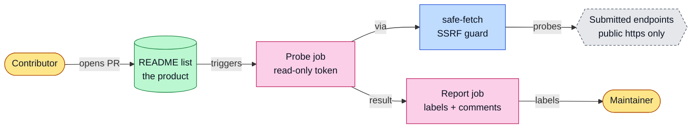
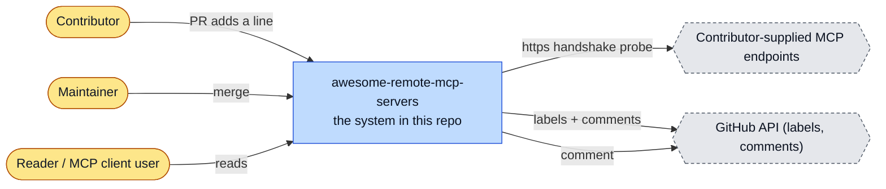
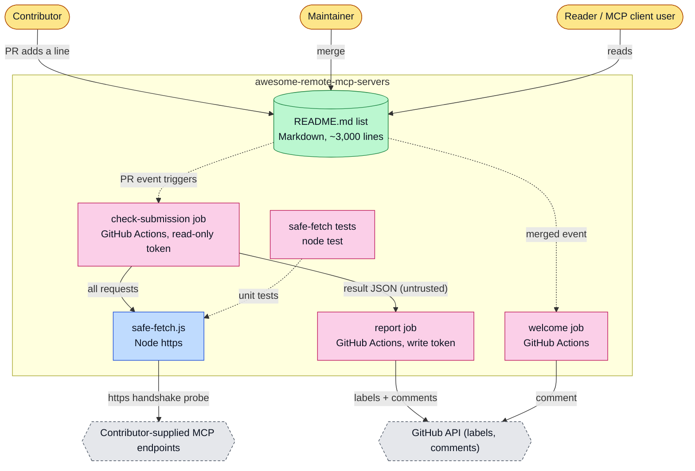
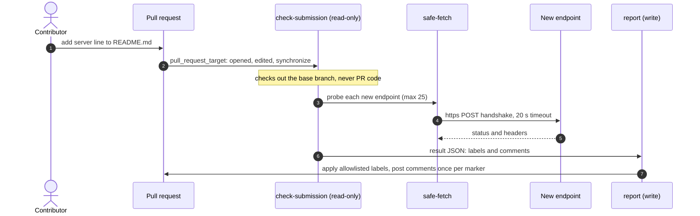
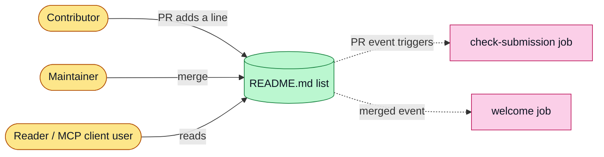
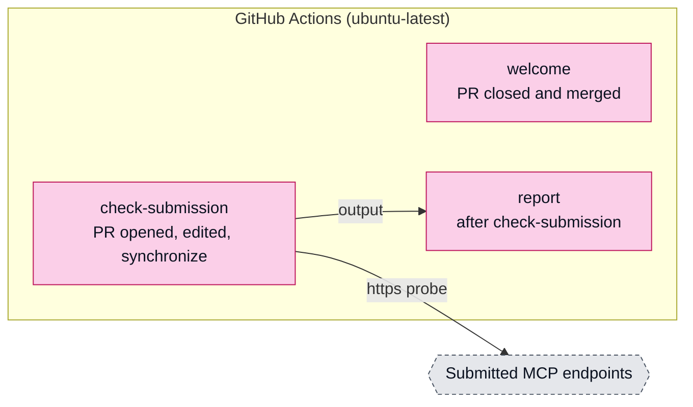

# awesome-remote-mcp-servers: architecture

<!-- arch-kit:generated -->

> Whiteboard-level structure: what systems exist, what they talk to, and when they run. Evidence-backed; every box below maps to a path listed in [Evidence](#10-evidence).
> Generated by the ArchDocs kit from repo commit `5646a52f9c`. Diagram sources: [`architecture/*.mmd`](architecture/). Hi-res renders sit next to each source.

## 1. Purpose

This repository is a fork of a curated list of remote Model Context Protocol servers: hosted endpoints you connect to by URL, with no local install. The list is `README.md`. The one piece of running code is the submission checker: when a pull request adds a server, a GitHub Actions workflow parses the diff, probes each new endpoint over HTTPS with an SSRF-guarded client, and labels and comments on the pull request. The thefiredev-cloud changes split that workflow into an unprivileged probe job and a privileged reporting job.

## 2. Whiteboard view

Seven boxes. The privileged job never touches contributor URLs; the job that does has a read-only token.

Hi-res: [SVG](architecture/whiteboard.svg) · [PNG 3x](architecture/whiteboard@3x.png) · [dark SVG](architecture/whiteboard.dark.svg) · [dark PNG 3x](architecture/whiteboard.dark@3x.png)

Explorable version (Archify, standalone HTML, download and open locally): [`architecture/awesome-remote-mcp-servers.archify.html`](architecture/awesome-remote-mcp-servers.archify.html)

## 3. System context (C4 level 1)

Who and what touches the system from outside.

Hi-res: [SVG](architecture/context.svg) · [PNG 3x](architecture/context@3x.png)

## 4. Containers and components (C4 level 2)

The parts that run or hold data inside the repo's system boundary.

Hi-res: [SVG](architecture/containers.svg) · [PNG 3x](architecture/containers@3x.png)

| Container | Kind | Tech | What it does | Evidence |
|---|---|---|---|---|
| README.md list | store | Markdown, ~3,000 lines | The curated server list. | [`README.md#L1-L25`](../README.md#L1-L25) |
| check-submission job | job | GitHub Actions, read-only token | Checks out the BASE branch, parses the PR diff, probes new endpoints (max 25 per PR). | [`.github/workflows/check-submission.yml#L46-L73`](../.github/workflows/check-submission.yml#L46-L73), [`.github/scripts/check-submission.js#L10-L14`](../.github/scripts/check-submission.js#L10-L14) |
| safe-fetch.js | app | Node https | https on 443 only, DNS names only, public addresses only, validated connect address, re-validated redirects (max 3). | [`.github/scripts/safe-fetch.js#L89-L103`](../.github/scripts/safe-fetch.js#L89-L103), [`.github/scripts/safe-fetch.js#L162-L180`](../.github/scripts/safe-fetch.js#L162-L180) |
| report job | job | GitHub Actions, write token | Runs no contributor URL probes. Allowlists label names and comment ids, caps bodies at 60,000 chars. | [`.github/workflows/check-submission.yml#L78-L127`](../.github/workflows/check-submission.yml#L78-L127) |
| welcome job | job | GitHub Actions | Posts a thank-you comment once a PR is merged. | [`.github/workflows/check-submission.yml#L12-L39`](../.github/workflows/check-submission.yml#L12-L39) |
| safe-fetch tests | job | node test | Unit tests for the guard. | [`.github/scripts/safe-fetch.test.js`](../.github/scripts/safe-fetch.test.js) |

## 5. Key runtime sequences

### 5.1 A pull request adds a server

Two jobs on purpose: the one that talks to strangers cannot write, the one that writes never talks to strangers.

Hi-res: [SVG](architecture/sequence-1.svg) · [PNG 3x](architecture/sequence-1@3x.png)

## 6. Data flow and stores

How data moves between components and where it rests.

Hi-res: [SVG](architecture/dataflow.svg) · [PNG 3x](architecture/dataflow@3x.png)

## 7. Deployment and runtime topology

No servers. All code runs in GitHub Actions on pull-request events.

Hi-res: [SVG](architecture/deployment.svg) · [PNG 3x](architecture/deployment@3x.png)

| What | Where | Runs when | Trigger / port | Evidence |
|---|---|---|---|---|
| check-submission | GitHub Actions | On every opened, edited or synchronized PR | pull_request_target | [`.github/workflows/check-submission.yml#L3-L5`](../.github/workflows/check-submission.yml#L3-L5), [`.github/workflows/check-submission.yml#L46-L47`](../.github/workflows/check-submission.yml#L46-L47) |
| welcome comment | GitHub Actions | When a PR is merged | action closed and merged | [`.github/workflows/check-submission.yml#L13-L14`](../.github/workflows/check-submission.yml#L13-L14) |

## 8. Failure modes and how to see them

| Failure | What the user sees | How to see it | Evidence |
|---|---|---|---|
| Endpoint unreachable or wrong URL | PR labelled endpoint-unreachable with a comment | Labels and comments on the PR | [`.github/scripts/check-submission.js#L139-L144`](../.github/scripts/check-submission.js#L139-L144), [`.github/workflows/check-submission.yml#L95-L98`](../.github/workflows/check-submission.yml#L95-L98) |
| More than 25 new entries in one PR | Extra entries are not probed | Comment `not probed: more than 25 new entries` | [`.github/scripts/check-submission.js#L10`](../.github/scripts/check-submission.js#L10), [`.github/scripts/check-submission.js#L140-L143`](../.github/scripts/check-submission.js#L140-L143) |
| Contributor points a probe at an internal address | Blocked before connect; EBLOCKED | Error from guarded lookup | [`.github/scripts/safe-fetch.js#L105-L116`](../.github/scripts/safe-fetch.js#L105-L116) |
| Result JSON carries unexpected labels | Dropped by the allowlist | Label missing from the PR | [`.github/workflows/check-submission.yml#L95-L107`](../.github/workflows/check-submission.yml#L95-L107) |

## 9. State machine

No state machine in this repo. A submission's status is carried by PR labels (endpoint-ok, endpoint-unreachable, has-connector, missing-connector, invalid-format, duplicate).

## 10. Evidence

Every path below exists at the pinned commit; links are relative to `docs/`.

| Path | Why it matters |
|---|---|
| [`.github/workflows/check-submission.yml`](../.github/workflows/check-submission.yml) | Three jobs: welcome, unprivileged check-submission, privileged report. |
| [`.github/scripts/check-submission.js`](../.github/scripts/check-submission.js) | Diff parser and endpoint prober (max 25 probes). |
| [`.github/scripts/safe-fetch.js`](../.github/scripts/safe-fetch.js) | SSRF guard: https only, public addresses only, validated redirects. |
| [`.github/scripts/safe-fetch.test.js`](../.github/scripts/safe-fetch.test.js) | Tests for the guard. |
| [`README.md`](../README.md) | The curated list. |
| [`CONTRIBUTING.md`](../CONTRIBUTING.md) | How to submit a server. |

Collected mechanically by the kit ([`architecture/facts.json`](architecture/facts.json), not hand-edited):

- CI: `.github/workflows/check-submission.yml`
- external hosts seen in source: `glama.ai`, `homepage.example`

Graphify (local AST, no LLM) read this repo: 92 nodes, 107 edges, 7 communities. Most connected: `Servers` (42), `guardedRequest()` (8), `Awesome Remote MCP Servers ` (8), `isPublicAddress()` (5), `makeGuardedLookup()` (5).

- Report: [`architecture/graphify/GRAPH_REPORT.md`](architecture/graphify/GRAPH_REPORT.md)
- Interactive graph: [`architecture/graphify/graph.html`](architecture/graphify/graph.html) (86 KB, download and open locally)
